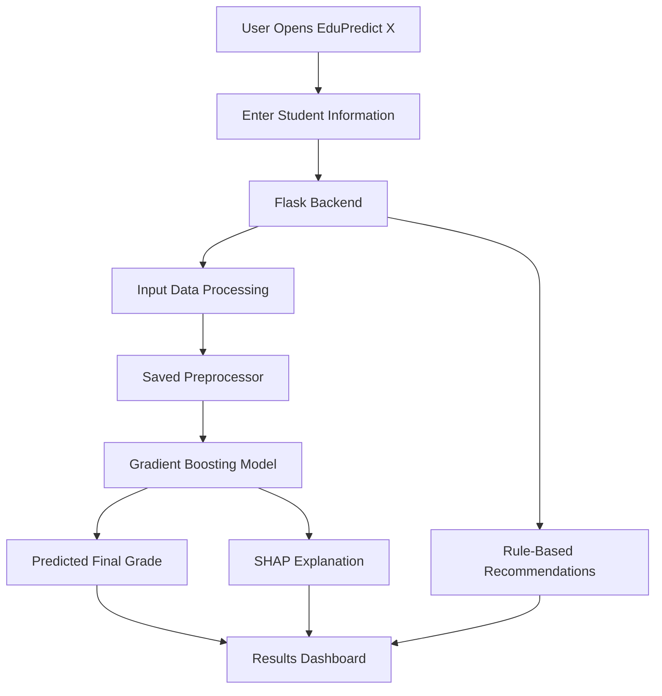

# EduPredict X
### Explainable AI-Based Student Performance Prediction System

**Predict. Understand. Improve.**

EduPredict X is an AI-powered student performance prediction web application that estimates a student's final academic grade using demographic, social, family, and academic information.

Unlike a basic prediction system that only provides a numerical result, EduPredict X integrates **Explainable Artificial Intelligence (XAI)** using SHAP (SHapley Additive exPlanations) to help users understand which input features influenced the prediction.

The project also provides personalized, rule-based recommendations to help identify areas where students may need additional academic support.

**Live Application:** https://student-performance-prediction-19g1.onrender.com

**GitHub Repository:** https://github.com/Deepanshu211107/student-performance-prediction

---

## Table of Contents

1. [Project Overview](#-project-overview)
2. [Problem Statement](#-problem-statement)
3. [Key Features](#-key-features)
4. [Application Screenshots](#-application-screenshots)
5. [Technology Stack](#-technology-stack)
6. [System Architecture](#-system-architecture)
7. [Machine Learning Workflow](#-machine-learning-workflow)
8. [Dataset Description](#-dataset-description)
9. [Model Performance](#-model-performance)
10. [Explainable AI with SHAP](#-explainable-ai-with-shap)
11. [Recommendation System](#-recommendation-system)
12. [Project Structure](#-project-structure)
13. [Installation and Setup](#-installation-and-setup)
14. [How to Use](#-how-to-use)
15. [Limitations](#-limitations)
16. [Future Enhancements](#-future-enhancements)
17. [Disclaimer](#-disclaimer)
18. [Author](#-author)

---

## 📌 Project Overview

EduPredict X aims to make student performance prediction more understandable and actionable.

The application collects information about a student's academic habits, family background, school environment, and personal circumstances. It processes these inputs using a trained Gradient Boosting Regression model to estimate the student's final grade (G3) on a scale of 0–20.

The system combines three major components:

- **Machine Learning:** Predicts the estimated final grade.
- **Explainable AI:** Uses SHAP to explain the influence of individual input features.
- **Recommendation Engine:** Generates suggestions using predefined academic-support rules.

The main objective is not just to predict a grade, but also to provide insight into the factors associated with that prediction.

## 🎯 Problem Statement

Traditional student performance prediction systems often provide a prediction without explaining how the result was generated.

This creates several problems:

- Students may not understand the factors influencing their predicted performance.
- Educators may find it difficult to interpret model outputs.
- A numerical prediction alone does not indicate potential areas for improvement.
- Black-box machine learning models can be difficult to trust.

EduPredict X addresses these challenges by combining predictive modelling with feature-level explanations and actionable recommendations.

## ✨ Key Features

### 1. Student Performance Prediction
- Predicts final student grades using a trained machine learning model.
- Uses Gradient Boosting Regression.
- Produces predictions on a 0–20 grading scale.
- Categorizes results into performance levels.

### 2. Explainable AI (SHAP)
- Generates explanations for individual predictions.
- Identifies influential student-related features.
- Displays positive and negative feature contributions.
- Helps users understand how the model arrived at its prediction.

### 3. Personalized Recommendations
- Provides suggestions based on selected student information.
- Identifies potential academic concerns.
- Prioritizes recommendations using High, Medium, and Low priority levels.

### 4. Model Performance Analysis
- Displays evaluation metrics such as MAE, MSE, and R².
- Compares multiple regression algorithms.
- Helps understand the relative performance of different models.

### 5. Modern User Interface
- Clean and responsive interface.
- Light and dark theme support.
- Interactive prediction results.
- Organized explanation and recommendation sections.

---

## 🖥️ Application Screenshots

Add screenshots of your actual deployed application in the following section.

Suggested screenshots:

| Screenshot | Description |
|---|---|
| `home.png` | EduPredict X landing page |
| `input-form.png` | Student information input form |
| `results.png` | Predicted grade and performance level |
| `shap-explanation.png` | SHAP feature explanations |
| `recommendations.png` | Personalized recommendations |
| `dark-mode.png` | Dark theme interface |

You can upload these images to a folder named `screenshots` in the repository and display them here.

Example:

```markdown

```

---

## 🛠️ Technology Stack

| Category | Technologies |
|---|---|
| Programming Language | Python |
| Backend Framework | Flask |
| Machine Learning | Scikit-learn |
| Data Processing | Pandas, NumPy |
| Model Persistence | Joblib |
| Explainable AI | SHAP |
| Frontend | HTML, CSS, JavaScript |
| Templates | Jinja2 |
| Development Tools | VS Code, Git, GitHub |
| Deployment | Render |

---

## 🏗️ System Architecture

The application follows a machine learning-based prediction workflow.



### Workflow Explanation

1. The user enters student-related information through the web interface.
2. Flask receives and validates the submitted information.
3. The preprocessing pipeline transforms the input into the format expected by the trained model.
4. The Gradient Boosting Regressor predicts the student's final grade.
5. SHAP calculates feature contributions to explain the prediction.
6. The recommendation engine generates suggestions using predefined rules.
7. The application displays the prediction, explanations, recommendations, and model evaluation information.

---

## 🤖 Machine Learning Workflow

The project follows a supervised machine learning regression approach.

### 1. Data Collection

The project uses the Student Performance dataset containing academic, demographic, social, and family-related attributes.

### 2. Data Preprocessing

The preprocessing stage includes:

- Handling numerical and categorical features.
- Encoding categorical variables.
- Preparing input features for model training.
- Separating features and the target variable.
- Preparing training and testing datasets.

A saved preprocessing pipeline is reused during prediction to maintain consistency between training and inference.

### 3. Model Training

Multiple regression algorithms were evaluated:

- Linear Regression
- Decision Tree Regressor
- Random Forest Regressor
- Gradient Boosting Regressor

### 4. Model Selection

Gradient Boosting Regressor was selected because it achieved the lowest Mean Absolute Error among the evaluated models.

### 5. Prediction

The selected model estimates the student's final grade (G3), with the displayed prediction constrained to the 0–20 scale.

---

## 📊 Dataset Description

**Dataset:** Student Performance Dataset

The dataset contains information related to students' academic performance and personal circumstances.

The model uses features from categories such as:

| Category | Example Features |
|---|---|
| Demographic | Age, Sex, Address |
| Family Background | Mother's education, Father's education, Family size |
| Academic | Study time, Previous failures, Absences |
| School Environment | School support, Internet access, School |
| Social Factors | Free time, Going out, Activities |
| Personal Factors | Health, Family relationship |

**Target Variable:** `G3`

G3 represents the student's final grade on a scale of 0–20.

The application uses 27 input features for prediction.

---

## 📈 Model Performance

Four regression algorithms were evaluated using the following metrics:

- **MAE (Mean Absolute Error):** Average absolute difference between actual and predicted grades.
- **MSE (Mean Squared Error):** Average squared prediction error.
- **R² Score:** Measures how much variation in the target variable is explained by the model.

### Model Comparison

| Model | MAE | MSE | R² Score |
|---|---:|---:|---:|
| Linear Regression | 3.51 | 18.19 | 0.11 |
| Decision Tree | 3.45 | 19.67 | 0.04 |
| Random Forest | 3.09 | 14.63 | 0.29 |
| **Gradient Boosting** | **3.05** | **14.64** | **0.29** |

### Selected Model: Gradient Boosting Regressor

The Gradient Boosting Regressor achieved:

- **MAE:** 3.05
- **MSE:** 14.64
- **R² Score:** 0.29

It was selected because it achieved the lowest MAE among the tested models.

The R² score indicates that the model has limited explanatory power on the evaluated test data. Therefore, its predictions should be treated as estimates rather than highly accurate representations of actual student performance.

---

## 🔍 Explainable AI with SHAP

One of the main components of EduPredict X is its integration of SHAP.

SHAP stands for **SHapley Additive exPlanations**. It is a model explainability technique based on concepts from cooperative game theory.

It helps explain how individual input features contribute to a model's prediction.

### How SHAP Works in EduPredict X

The application uses:

```python
explainer = shap.TreeExplainer(model)
```

For an individual prediction, SHAP calculates feature contribution values.

These values help identify:

- Features pushing the predicted grade higher.
- Features pushing the predicted grade lower.
- Features having relatively greater influence on the prediction.

### Understanding SHAP Values

| SHAP Contribution | Interpretation |
|---|---|
| Positive | Pushes the prediction higher |
| Negative | Pushes the prediction lower |
| Near Zero | Has relatively little influence on the prediction |

SHAP values are expressed in the target's units here, meaning grade points.

**Important:** SHAP explains the behaviour of the trained model. It does not establish that a particular student characteristic causes a change in academic performance.

---

## 💡 Recommendation System

EduPredict X also includes a rule-based recommendation engine.

It examines selected student inputs and generates suggestions based on predefined conditions.

Examples include:

| Identified Condition | Suggested Focus |
|---|---|
| Low study time | Develop a consistent study routine |
| High absences | Improve attendance |
| Previous academic failures | Strengthen academic foundations |
| Lack of school support | Explore available academic support |
| Long travel time | Manage commuting time effectively |

Recommendations are assigned priority levels:

- **High:** Areas requiring greater attention.
- **Medium:** Areas that may benefit from improvement.
- **Low:** Additional areas for consideration.

The recommendation engine currently uses manually defined rules rather than a separately trained machine learning model.

---

## 📁 Project Structure

```text
student-performance-prediction/
│
├── app.py
│
├── templates/
│   ├── index.html
│   └── result.html
│
├── gradient_boosting_regressor.pkl
├── preprocessor.pkl
│
├── requirements.txt
├── README.md
│
└── screenshots/
    ├── home.png
    ├── input-form.png
    ├── results.png
    ├── shap-explanation.png
    └── dark-mode.png
```

*This is the intended documented structure. Adjust it to match the actual files in your repository.*

---

## ⚙️ Installation and Setup

Follow these steps to run EduPredict X locally.

### Prerequisites

- Python 3.9 or later (depending on package compatibility).
- Git.
- A code editor such as VS Code.

### 1. Clone the Repository

```bash
git clone https://github.com/Deepanshu211107/student-performance-prediction.git
```

### 2. Navigate to the Project Directory

```bash
cd student-performance-prediction
```

### 3. Create a Virtual Environment

```bash
python -m venv venv
```

### 4. Activate the Virtual Environment

**Windows:**

```bash
venv\Scripts\activate
```

**macOS / Linux:**

```bash
source venv/bin/activate
```

### 5. Install Dependencies

```bash
pip install -r requirements.txt
```

### 6. Run the Application

```bash
python app.py
```

### 7. Open in Your Browser

Visit:

```text
http://127.0.0.1:5000/
```

**Note:** The trained model and preprocessing files must be available in the project directory. Ensure the saved artifacts are compatible with the installed Scikit-learn and other package versions.

---

## 🚀 How to Use

1. Open the EduPredict X application.
2. Navigate to the student information form.
3. Enter the required student details.
4. Submit the form.
5. View the predicted final grade.
6. Review the performance category.
7. Explore SHAP-based feature explanations.
8. Read the personalized recommendations.
9. Review the model performance metrics.

---

## ⚠️ Limitations

EduPredict X is an academic machine learning project and has several limitations.

1. **Limited Predictive Performance:** The selected model has an R² score of approximately 0.29 on the reported evaluation.
2. **Dataset Dependency:** Predictions depend on the patterns and limitations of the dataset used during training.
3. **Rule-Based Recommendations:** Recommendations are generated through manually defined rules and are not independently validated as interventions.
4. **No Causal Inference:** Feature contributions do not establish cause-and-effect relationships.
5. **Prediction Uncertainty:** The application does not currently provide a calibrated prediction interval.
6. **Generalization:** Performance on students from different institutions or educational systems has not been established.

The application should be used for educational exploration and decision-support research, not as the sole basis for academic decisions.

---

## 🔮 Future Enhancements

Potential improvements include:

- Expanding the training dataset with more diverse student records.
- Improving model performance through hyperparameter tuning.
- Applying cross-validation for more robust evaluation.
- Adding prediction intervals to communicate uncertainty.
- Developing more advanced recommendation strategies.
- Adding educator and administrator dashboards.
- Tracking student progress over multiple academic terms.
- Integrating additional explainability visualizations.
- Conducting fairness and bias evaluation across student groups.

---

## 📜 Disclaimer

EduPredict X is developed for educational, academic, and research purposes.

The predictions are estimates generated by a machine learning model and should not be considered guaranteed academic outcomes.

The system is not intended to replace teachers, academic counsellors, or professional educational assessments.

---

## 👨‍💻 Author

**Deepanshu Sharma**

B.Tech Computer Science and Engineering (AI & ML)

Lovely Professional University

**Interests:** Artificial Intelligence, Machine Learning, Python, Data Science and Problem Solving.

- GitHub: [@Deepanshu211107](https://github.com/Deepanshu211107)
- Project: [EduPredict X](https://github.com/Deepanshu211107/student-performance-prediction)

---

⭐ If you find this project interesting, consider starring the repository!

**EduPredict X — Predict. Understand. Improve.**